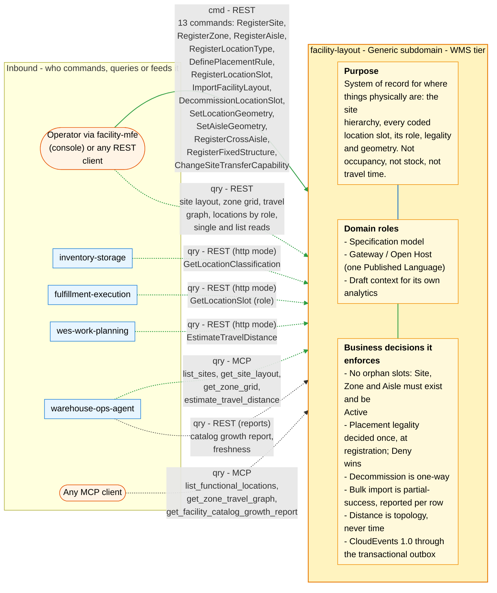
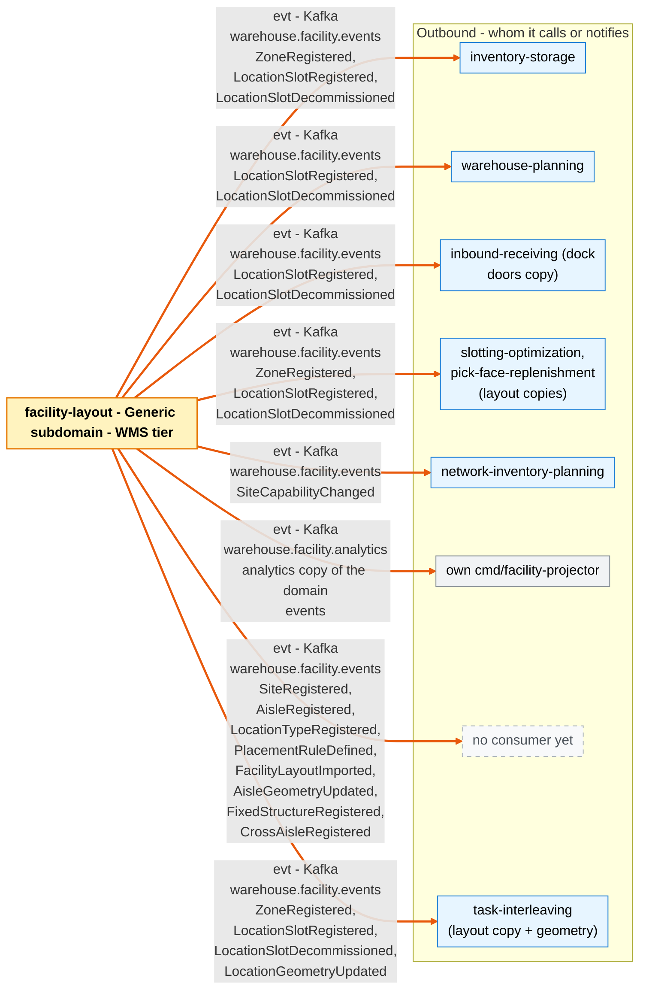

# Bounded Context Canvas

Following the [ddd-crew Bounded Context Canvas v5](https://github.com/ddd-crew/bounded-context-canvas).
Every message row below maps to a real REST route
(`internal/adapters/inbound/http/server.go`), MCP tool
(`internal/adapters/inbound/mcp/tools.go`, `report_tool.go`) or Kafka topic +
CloudEvents type (`internal/adapters/outbound/kafka/publisher.go`,
`internal/domain/shared/events.go`). REST and MCP are unauthenticated
([ADR 0015](../adr/0015-remove-rest-mcp-auth.md)).

## Canvas at a glance

Two pictures of the sections below, laid out like the ddd-crew canvas:
first the inbound collaborators feeding this context (purpose, domain roles
and the business decisions it enforces), then the outbound collaborators it
calls or notifies. Arrows follow the message type: **solid blue**
commands (`cmd`), **dotted green** queries (`qry`), **thick orange** events
(`evt`); each arrow names its channel and the messages it carries. Box shapes
mark the collaborator kind: rounded = people, UI or any client; blue =
sibling bounded context; double border = external system or platform;
grey = this context's own projector, reports or dead-letter path; dashed =
published today with no consumer. Channel names on the arrows are
abbreviated (REST, MCP, Kafka, HTTP, port); the Inbound and Outbound
Communication tables carry the exact route, tool, topic and CloudEvents
type for every message.

### Inbound

### Outbound

Source: the Inbound Communication and Outbound Communication tables of this
page, which map to `internal/adapters/inbound/{http,kafka,mcp}` and `internal/adapters/outbound/`. The diagram omits assumptions, verification metrics, open
questions and the ubiquitous language (sections below), the relationship
pattern per message (OHS, ACL, Conformist, Customer/Supplier - see the
tables) and anything the tables mark as deprecated or platform-only
(health probes).

## Name

**Facility Layout** (`facility-layout`, CloudEvents subdomain segment `wms`).

## Purpose

The system of record for **where things physically are in the building**:
the site hierarchy (Site → Area → Zone → Aisle) and the coded slots inside it
(`WH1-STOR-AMB-A07-03-02-B`). It owns whether a coded location **exists, is
active, and is legal for a given kind of storage unit**, what a location is
**for** (its `LocationRole`), and the map's **geometry and travel topology**.
It does **not** own occupancy or stock — that is `inventory-storage`'s — and
it does not own travel *time* or congestion — that is `wes-work-planning`'s.

## Strategic Classification

| Dimension | Value |
|---|---|
| **Domain** | **Generic Subdomain** — see [Subdomain classification](./subdomain-classification.md) and the [Core Domain Chart](./core-domain-chart.md) |
| **Business Model** | **Compliance / enabler** — it earns nothing directly; it prevents errors (orphan slots, ambient product in a frozen zone) for the revenue-generating Core contexts that consume it |
| **Evolution** | **Product** heading toward commodity — the model mirrors commercial WMS location masters (Oracle WMS Cloud, SAP EWM) |

## Domain Roles

| Role (ddd-crew archetype) | Why |
|---|---|
| **Specification model** | Its job is to answer "is this location real, active and legal?" — a rule/specification oracle for other contexts. |
| **Gateway / Open Host** | It publishes one general-purpose Published Language (12 CloudEvents types + REST + MCP) for every consumer instead of bilateral contracts. |
| **Draft context for analytics** | Its own events feed its own analytics data product (`cmd/facility-projector`, [ADR 0010](../adr/0010-analytical-data-product.md)). |

## Inbound Communication

Who sends messages **into** this context. Collaborators are the callers
verified in their own repositories' `develop` (see the
[Context map](../ecosystem/context-map.md)).

| Collaborator | Message | Type | Channel | Relationship |
|---|---|---|---|---|
| Operator via `facility-mfe` (console) | RegisterSite | Command | REST `POST /sites` | Customer of own OHS |
| Operator via `facility-mfe` | RegisterZone | Command | REST `POST /sites/{siteCode}/zones` | Customer of own OHS |
| Operator via `facility-mfe` | RegisterAisle | Command | REST `POST /zones/{zoneId}/aisles` | Customer of own OHS |
| Operator via `facility-mfe` | RegisterLocationType | Command | REST `POST /location-types` | Customer of own OHS |
| Operator via `facility-mfe` | DefinePlacementRule | Command | REST `POST /placement-rules` | Customer of own OHS |
| Operator via `facility-mfe` | RegisterLocationSlot | Command | REST `POST /locations` | Customer of own OHS |
| Operator via `facility-mfe` | ImportFacilityLayout | Command | REST `POST /locations/import` | Customer of own OHS |
| Operator / REST client | DecommissionLocationSlot | Command | REST `POST /locations/{locationCode}/decommission` | Customer of own OHS |
| Operator / REST client | SetLocationGeometry | Command | REST `PUT /locations/{locationCode}/geometry` | Customer of own OHS |
| Operator / REST client | SetAisleGeometry | Command | REST `PUT /zones/{zoneId}/aisles/{aisleCode}/geometry` | Customer of own OHS |
| Operator / REST client | RegisterCrossAisle | Command | REST `POST /zones/{zoneId}/cross-aisles` | Customer of own OHS |
| Operator / REST client | RegisterFixedStructure | Command | REST `POST /sites/{siteCode}/structures` | Customer of own OHS |
| Operator / REST client | ChangeSiteTransferCapability | Command | REST `PUT /sites/{siteCode}/transfer-capability` ([ADR 0035](../adr/0035-site-transfer-capability-command.md)) | Customer of own OHS |
| `inventory-storage` | GetLocationClassification | Query | REST `GET /locations/{locationCode}/classification` (`LOCATION_LOOKUP_MODE=http`) | Conformist (D) of OHS (U) |
| `fulfillment-execution` | GetLocationSlot (reads `role`) | Query | REST `GET /locations/{locationCode}` (`LOCATION_ROLE_MODE=http`) | Conformist (D) of OHS (U) |
| `wes-work-planning` | EstimateTravelDistance | Query | REST `GET /distance?from=&to=` (`TRAVEL_DISTANCE_MODE=http`) | Conformist (D) of OHS (U) |
| `warehouse-ops-agent` | list sites / site layout / zone grid / travel distance | Query | MCP `list_sites`, `get_site_layout`, `get_zone_grid`, `estimate_travel_distance` | Conformist (D) of OHS (U) |
| `warehouse-ops-agent` | Catalog growth report | Query | REST `GET /reports/catalog-growth`, `GET /reports/catalog-growth/freshness` on `cmd/facility-reports` | Conformist (D) of OHS (U) |
| `facility-mfe` / any client | Read models: site layout, zone grid, travel graph, locations by role, single-resource and list reads | Query | REST `GET /sites/{siteCode}/layout`, `GET /zones/{zoneId}/grid`, `GET /zones/{zoneId}/travel-graph`, `GET /sites/{siteCode}/locations?role=`, and the other `GET` routes | Customer of own OHS |
| Any MCP client | Functional locations / travel graph / catalog report | Query | MCP `list_functional_locations`, `get_zone_travel_graph`, `get_facility_catalog_growth_report` (the last only when `REPORTS_BASE_URL` is set) | OHS |

This context consumes **no** event from any other context — the only Kafka
consumer in the repository (`internal/adapters/inbound/kafka/analytics_consumer.go`)
reads this context's own `warehouse.facility.analytics` topic.

## Outbound Communication

Every domain event goes to **both** topics
(integration `warehouse.facility.events`, analytics
`warehouse.facility.analytics`). CloudEvents type prefix:
`com.warehouse.wms.facility-layout.`

| Collaborator | Message | Type | Channel | Relationship |
|---|---|---|---|---|
| `inventory-storage` (`facilitycache`), `slotting-optimization`, `pick-face-replenishment`, `task-interleaving` (layout copies) | ZoneRegistered | Event | Kafka `warehouse.facility.events` — `com.warehouse.wms.facility-layout.zone.ZoneRegistered` | OHS + PL (U) → Conformist + ACL (D) |
| `inventory-storage`, `warehouse-planning`, `inbound-receiving` (dock-door copy), `slotting-optimization`, `pick-face-replenishment`, `task-interleaving` (layout copies) | LocationSlotRegistered | Event | Kafka `warehouse.facility.events` — `com.warehouse.wms.facility-layout.locationslot.LocationSlotRegistered` | OHS + PL (U) → Conformist + ACL (D) |
| `inventory-storage`, `warehouse-planning`, `inbound-receiving` (dock-door copy), `slotting-optimization`, `pick-face-replenishment`, `task-interleaving` (layout copies) | LocationSlotDecommissioned | Event | Kafka `warehouse.facility.events` — `com.warehouse.wms.facility-layout.locationslot.LocationSlotDecommissioned` | OHS + PL (U) → Conformist + ACL (D) |
| `task-interleaving` (layout copy) | LocationGeometryUpdated | Event | Kafka `warehouse.facility.events` — `com.warehouse.wms.facility-layout.locationslot.LocationGeometryUpdated` | OHS + PL (U) → Conformist + ACL (D) |
| `network-inventory-planning` (`SiteCapabilityConsumer`) | SiteCapabilityChanged | Event | Kafka `warehouse.facility.events` — `com.warehouse.wms.facility-layout.site.SiteCapabilityChanged` (snake_case payload, ADR 0035) | OHS + PL (U) → Conformist + ACL (D) |
| own `cmd/facility-projector` | SiteRegistered, ZoneRegistered, AisleRegistered, LocationTypeRegistered, PlacementRuleDefined, LocationSlotRegistered, LocationSlotDecommissioned, FacilityLayoutImported | Event | Kafka `warehouse.facility.analytics` — same `type` strings, `dataschema` `urn:warehouse:facility-layout:analytics:<EventName>:v1` | same context |
| no consumer yet | SiteRegistered, AisleRegistered, LocationTypeRegistered, PlacementRuleDefined, FacilityLayoutImported | Event | Kafka `warehouse.facility.events` — `...site.SiteRegistered`, `...aisle.AisleRegistered`, `...locationtype.LocationTypeRegistered`, `...placementrule.PlacementRuleDefined`, `...locationslot.FacilityLayoutImported` | OHS + PL |
| no consumer yet | AisleGeometryUpdated, FixedStructureRegistered, CrossAisleRegistered | Event | Kafka `warehouse.facility.events` — `...aisle.AisleGeometryUpdated`, `...structure.FixedStructureRegistered`, `...crossaisle.CrossAisleRegistered` | OHS + PL |

This context sends **no** command or query to any other context: there is
no outbound REST/MCP client in `internal/adapters/outbound/`.

## Ubiquitous Language

Full glossary: [Ubiquitous language](../business-context/ubiquitous-language.md).
Top terms:

| Term | Code identifier |
|---|---|
| Site | `site.Site` |
| Zone (Area + Zone segments) | `zone.Zone` |
| Aisle, SequenceHint, Direction | `aisle.Aisle`, `shared.Direction` |
| LocationSlot | `slot.LocationSlot` |
| LocationCode | `shared.LocationCode` |
| LocationType, LocationRole | `placement.LocationType`, `placement.LocationRole` |
| PlacementRule, ZonePredicate, Allow/Deny | `placement.PlacementRule`, `placement.ZonePredicate`, `placement.Effect` |
| Chain of custody | `RegisterLocationSlot.resolveChain` |
| Decommission (one-way) | `Decommission()` on each structural aggregate |
| Travel graph, waypoint | `travel.Graph`, `travel.Node` |

## Business Decisions

- **No orphan slots, ever**: a slot is registered only if its Site, Zone and
  Aisle exist and are `Active` (`resolveChain`).
- **Placement legality is decided once, at registration**: Deny wins; any
  matching Allow turns a zone into an allow-list
  ([ADR 0003](../adr/0003-placement-rules-at-registration-time.md)). Rule
  changes never retroactively invalidate existing slots
  (`RehydrateLocationSlot` skips the check).
- **Decommission is one-way**; re-registering a retired code is a
  `409 duplicate-location-code` ([ADR 0005](../adr/0005-one-way-decommission.md)).
- **Bulk import is partial-success**, reported per row
  ([ADR 0006](../adr/0006-partial-success-bulk-import.md)).
- **Capacity is required only for roles that hold stock** (`Storage`,
  `Staging`, `Drop`, `Consolidation`); `Dock` needs a `dockFlow`,
  `WorkCenter` at least one activity
  ([ADR 0016](../adr/0016-functional-location-roles.md)).
- **Distance is topology, never time**; cross-zone distance is a flagged
  straight-line estimate only when both slots have geometry, else refused
  ([ADR 0017](../adr/0017-geometry-and-travel-graph.md)).
- **Every Kafka message is CloudEvents 1.0, structured mode**
  ([ADR 0024](../adr/0024-cloudevents-mandatory-envelope.md)); with a
  database, events leave through the transactional outbox
  ([ADR 0018](../adr/0018-transactional-outbox.md)).

## Assumptions

- Consumers tolerate this service being down: the Kafka consumers keep local
  copies, and the two REST callers (`wes-work-planning`, `fulfillment-execution`)
  wrap the call in a circuit breaker and fall back to their `permissive`
  behaviour. `inventory-storage` can run from its Kafka-fed cache.
- A building's layout changes slowly (hundreds to thousands of writes per
  day, mostly during commissioning), so per-day analytics buckets and
  single-row optimistic concurrency on `location_slots` only
  ([ADR 0025](../adr/0025-optimistic-concurrency-version-column.md)) are
  enough.
- Site coordinates are local metres with an arbitrary origin; no geodesy
  (`shared.Point3D`).

## Verification Metrics

| Metric | Source |
|---|---|
| `facility.location_slot.registrations` counter by `outcome` = `accepted` / `rejected_by_placement_rule` / `rejected` | `internal/adapters/outbound/telemetry/metrics.go`, `usecases.registrationOutcome` |
| `http.server.request.duration`, `http.server.active_requests` | `otelchimetric` middleware in `inbound/http/server.go` |
| Analytics freshness lag | `GET /reports/catalog-growth/freshness` |
| Catalog growth per site/zone per day | `GET /reports/catalog-growth`, table `catalog_growth_rollup` |
| Outbox backlog | rows in `outbox_events` with `published_at IS NULL` |

## Open Questions

- Should the travel graph connect zones with a routed path rather than a
  straight-line estimate? (open, [ADR 0017](../adr/0017-geometry-and-travel-graph.md);
  `estimate_travel_distance.go:38-41`)
- Should cross-aisles carry their own geometry? Today every cross-aisle edge
  is estimated from the zone's bay pitch (`travel.crossAisleDistance`).
- Should `FixedStructure` obstacles constrain the travel graph? The domain
  comment says "in a later phase".
- There is no use case that sets `UnderMaintenance`, decommissions a Site,
  Zone, Aisle or CrossAisle, or deletes a placement rule — the methods exist
  on the aggregates but nothing exposes them.
- Nine of the fourteen event types have no external consumer. Is the
  geometry Published Language worth its contract cost? Only
  `task-interleaving` consumes one geometry event (`LocationGeometryUpdated`);
  `wes-work-planning` still reads distance over REST.
