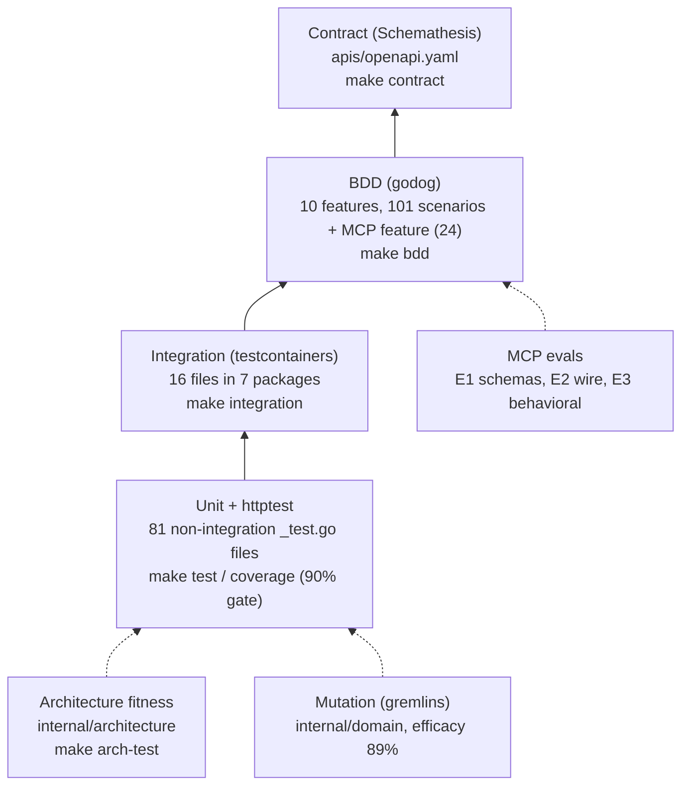

# Testing

This page describes the test suite as it exists on `develop`: what each layer
proves, how to run it locally (`Makefile`), and which CI job
(`.github/workflows/ci.yml`) enforces it. Every local target is the same
command its CI job runs.

Source: `Makefile`, `.github/workflows/ci.yml`, `features/`, `internal/architecture/`, `.gremlins.yaml`.

## Local targets

| Target | Command | Needs |
|---|---|---|
| `make check` | `fmt-check vet build lint test` (lefthook **pre-push**) | Go, golangci-lint v2.13.1 |
| `make check-all` | `check` + `coverage arch-test bdd` | same |
| `make test` | `go test ./... -race`: unit, httptest and BDD together | nothing external |
| `make coverage` | `go test ./... -race -coverprofile=coverage.out -coverpkg=./internal/domain/...,./internal/application/...` plus a **90%** gate | nothing external |
| `make integration` | `go test -tags=integration ./... -race -count=1` | Docker only |
| `make bdd` | `go test ./... -run TestFeatures -v` | nothing external |
| `make contract` | `scripts/contract-test.sh` | `st` (`pip install 'schemathesis==4.28.0'`) |
| `make arch-test` | `go test ./internal/architecture/... -v` | nothing external |
| `make mutation` | `gremlins unleash ./internal/domain` | gremlins v0.6.0 |
| `make vuln` | `govulncheck ./...` | govulncheck |
| `make guide-lint` / `make harness-test` | agent-guide lint and hook tests (Python) | python3 |

lefthook **pre-commit** runs `make fmt-check`, `make vet` and `make lint`.
Neither hook needs a database.

## Unit tests

Unit tests are plain `go test`, with in-memory adapters and `httptest` for
the HTTP adapter. The coverage gate measures only
`internal/domain/...` and `internal/application/...`, at a 90% threshold, in
both `make coverage` and the CI `test` job.

## BDD (godog)

- `features_test.go` (`TestFeatures`) drives the **real chi router** over a
  TCP `httptest.Server`, wired with the in-memory adapters, a fixed clock and
  a buffered event publisher. Every scenario is a black-box test of the REST
  API.
- There are **10 feature files under `features/`** with **101 `Scenario` /
  `Scenario Outline` headings**: `catalog_reads` 7, `draw_the_warehouse` 4,
  `error_contract` 7, `fixed_structures_and_cross_aisles` 21, `geometry` 18,
  `import` 2, `location_roles_and_reads` 14, `placement_rules` 4,
  `structure` 6, `travel_graph` 18. Outlines expand to more runtime cases.
- Scenarios tagged `@known-bug` describe the correct behaviour for a defect
  that is still open. The default filter `~@known-bug` skips them.
  `BDD_TAGS=@known-bug go test -run TestFeatures` runs only those scenarios.
  The tag currently appears in `fixed_structures_and_cross_aisles.feature`.
- A separate MCP feature,
  `internal/adapters/inbound/mcp/testdata/features/mcp_tools.feature`
  (24 scenarios), is run by `TestMCPEvalSuite` in the MCP package.

## Integration tests (`-tags=integration`)

Each suite boots its own Postgres 16 (and Kafka where needed) through
**testcontainers-go**. There are no service containers and no
`DATABASE_URL`/`KAFKA_BROKERS` skip gates: architecture fitness tests forbid
both.

| Package | Files |
|---|---|
| `internal/adapters/outbound/postgres` | `integration_test.go` (shared container and migrations), `repos_`, `version_` (optimistic concurrency), `travel_`, `geometry_`, `telemetry_` (otelpgx child spans), `pool_limits_` (MaxConns / statement_timeout), `pool_alias_`, `outbox_`, `sweeper_` |
| `internal/adapters/outbound/analyticsstore` | `postgres_integration_test.go` (projection and report) |
| `internal/adapters/outbound/kafka` | `publisher_partition_integration_test.go` (Hash balancer keeps aggregate order) |
| `internal/adapters/inbound/kafka` | `analytics_dlq_integration_test.go` (retry then DLQ) |
| `internal/adapters/inbound/http` | `idempotency_integration_test.go` (Idempotency-Key replay and reuse) |
| `internal/adapters/inbound/mcp` | `streamable_http_integration_test.go` |
| `internal/application/usecases` | `usecases_wiring_integration_test.go` |

The CI `integration` job runs `go test -tags=integration ./... -race -count=1`,
so every tagged package runs, the same as `make integration`.

## Contract tests (Schemathesis)

`scripts/contract-test.sh` builds `cmd/facility`, boots it in-memory on
`127.0.0.1:18081` (override with `CONTRACT_PORT`), waits for `/healthz`, and
runs `st run apis/openapi.yaml` with 100 examples per operation
(`CONTRACT_MAX_EXAMPLES`) and 4 workers.

Six operations are excluded because their cross-field rules cannot be
expressed in OpenAPI 3.0.3. The script names the test that covers each one:
`registerLocationType`, `registerLocationSlot`, `importFacilityLayout`,
`registerCrossAisle`, `setAisleGeometry` and `registerZone`. The
`allow_header_conformance` check is also excluded. The reports API
(`/reports/...`) and MCP are not in the spec, so this job does not cover
them.

## Architecture fitness tests (`internal/architecture`)

| Test | Rule |
|---|---|
| `TestHexagonalArchitecture` | Hexagonal dependency direction: domain → application → adapters (arch-go) |
| `TestMCPAdapterDependencyRule` | `internal/adapters/inbound/mcp` may depend only on the application and domain layers, never on outbound adapters or `cmd`. Nothing else may import it. |
| `TestNoAuthMiddlewareReintroduced` | No bearer or JWT middleware returns to `internal/adapters/inbound`: REST and MCP stay unauthenticated (ADR-0015) |
| `TestKafkaConsumerGroupNeverHardcodedInline` | A kafka-go `GroupID` must come from a named symbol, never an inline string literal |
| `TestKafkaIntegrationTestsUseTestcontainers`, `TestPostgresIntegrationTestsUseTestcontainers` (+ sensor self-test) | No env-gated skips. Real containers are required. |
| `TestCloudEventsOnly` | No envelope-mode toggle anywhere, and a module that talks to Kafka imports the CloudEvents SDK (ADR-0024) |
| `TestReplayConsumersSetCommitInterval` | A reader with a process-unique group must set `CommitInterval`. Nothing in this repo matches, because the projector's group is fixed and shared. |
| `TestEventCatalogueMatchesContract` (+ detector self-test) | Every CloudEvents type this service declares for itself in `apis/asyncapi.yaml` also appears in a CloudEvents ADR under `docs/docs/adr/` |
| `TestNoStructTagsInDomain` (+ sensor self-test) | No serialisation tags in `internal/domain` |
| `TestSiteCapabilityChangedContractPublishesFullLWWState` | The `SiteCapabilityChanged` message in the AsyncAPI carries the full last-write-wins state |

## MCP evals

The CI `evals-tests` job runs
`go test ./internal/adapters/inbound/mcp/... -race -run '^TestEval|^TestMCPEvalSuite' -v`:

- **E1, governance**: input schemas resolve and constrain, parameters are
  described, the tool registry matches its golden file, and fleet tool names
  are globally unique.
- **E2, wire conformance**: initialize handshake, unknown tool, wrong-typed
  or extra arguments, resource templates, prompts, session close.
- **E3, behavioural**: `TestMCPEvalSuite` runs `mcp_tools.feature`.

## Mutation testing (gremlins)

`.gremlins.yaml` pins 2 workers, a timeout coefficient of 30, and thresholds
**efficacy 89%** and **mutant-coverage 95%**. The last measurement was 99
mutants with 89 killed, 89.90% efficacy and 100% coverage (see
`MUTATION.md`). The default mutator set is listed explicitly.

- `mutation-fast` runs on every push and PR, blocking, with
  `gremlins unleash ./internal/domain`.
- `mutation` runs weekly (Monday 06:00 UTC) or on dispatch with
  `--workers 1 --timeout-coefficient 30`. It opens a `harness:red` issue on
  failure.

## CI jobs (`.github/workflows/ci.yml`)

| Job | Runs | When |
|---|---|---|
| `lint` | golangci-lint v2.13.1 | push / PR |
| `guide-lint` | `scripts/harness/guide_lint.py`, `repo_lint.py`, `test_hook.py`, `test_repo_lint.py` | push / PR |
| `complexity` | golangci-lint `--enable-only gocyclo,gocognit,cyclop,funlen,nestif`, plus a gocyclo report of functions over 10 (informational) | push / PR |
| `test` | `go build`, `go vet`, unit tests with `-race`, 90% coverage gate | push / PR |
| `bdd` | `go test ./... -run TestFeatures -v` | push / PR |
| `contract` | Schemathesis 4.28.0 through `scripts/contract-test.sh` | push / PR |
| `evals-tests` | MCP evals (see above) | push / PR |
| `integration` | build, vet and test with `-tags=integration` (testcontainers) | push / PR |
| `mutation-fast` | gremlins over `./internal/domain` | push / PR |
| `vuln` | govulncheck v1.8.0 | push / PR |
| `api-lint` | Spectral over `apis/openapi.yaml` (`--fail-severity=warn`) | push / PR |
| `docs-api-drift` | `npm run clean-api-docs && npm run gen-api-docs`, then `git diff --exit-code -- docs/api-reference/rest` | push / PR |
| `arch-test` | `go test ./internal/architecture/... -v` | push / PR |
| `web` | Builds warehouse-ui-kit, then lint, `tsc -b`, vitest and build of `web/` | push / PR |
| `helm-lint` | `ct lint` on `charts/facility-layout` | PR into `main` only |
| `trivy-scan` | Image build plus Trivy (blocks on CRITICAL/HIGH with a fix) | PR into `main` only |
| `mutation`, `drift` | Full mutation run. Drift covers deadcode, `go mod tidy -diff`, knip and coverage quality. | schedule / dispatch only |
| `docker-publish`, `release` | GHCR image, cosign signature, SBOM attestation, git tag, Helm chart to `oci://ghcr.io/iqvo` | push to `main` only |

On a PR into `develop`, `helm-lint`, `trivy-scan`, `mutation`, `drift`,
`docker-publish` and `release` report **skipped** because of their `if:`
conditions. That is expected.
