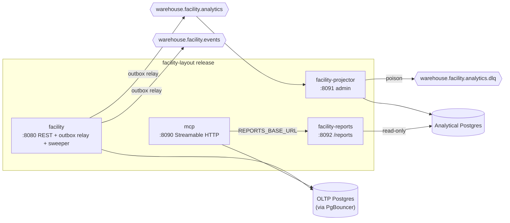

# Operations runbook

This page covers how facility-layout is deployed, what each process does at
runtime, and the routine procedures an operator needs. Every fact here comes
from `charts/facility-layout/`, `cmd/*/main.go` and the outbound adapters
on `develop`. Environment variables are listed in
[Configuration](./configuration.md).

## Deployment shape

There is one Helm chart, **`facility-layout`**
(`charts/facility-layout/Chart.yaml`, chart `0.1.0`). It deploys one image,
`iqvo/facility-layout`, containing every binary under `/app/`, plus an
optional frontend image. Every Deployment except the main one is disabled by
default.

| Deployment (name) | Binary / command | Enabled by | Container port | Service | Probes |
|---|---|---|---|---|---|
| `<fullname>` (component `api`) | `facility` (image default entrypoint) | always | `http` 8080 (`service.targetPort`) | `<fullname>` ClusterIP :80 → 8080 | startup `/healthz` (2s × 30), liveness `/healthz`, readiness `/readyz` |
| `<fullname>-projector` | `/app/facility-projector` | `analytics.enabled` | `admin` 8091 | none | startup/liveness `/healthz`, readiness `/readyz` on `admin` |
| `<fullname>-reports` | `/app/facility-reports` | `analytics.enabled` | `http` 8092 | `<fullname>-reports` ClusterIP :80 → 8092 | startup/liveness `/healthz`, readiness `/readyz` |
| `<fullname>-mcp` | `/app/mcp` | `mcp.enabled` | `http` 8090 | `<fullname>-mcp` ClusterIP :8090 → 8090 | startup/liveness/readiness all `/healthz` |
| `<fullname>-frontend` | nginx-unprivileged serving `web/` | `frontend.enabled` | 8080 | ClusterIP :80 → 8080 | `/healthz` |

`terminationGracePeriodSeconds` is 30 on the api and projector pods.
North-south traffic comes in either through `ingress` (disabled by default)
or through a Gateway API `HTTPRoute` (`gatewayApi.enabled`, ADR-0029). In
the fleet, Kong (:8000) fronts the REST API. The exact path prefix is set in
warehouse-infra, not in this chart. The frontend is reached through
warehouse-infra's Nginx web gateway at `/mfes/facility-layout/` and never
through Kong. REST and MCP are unauthenticated (ADR-0015). MCP is reachable
only from inside the cluster.

Source: `cmd/facility/main.go`, `cmd/facility-projector/main.go`, `cmd/facility-reports/main.go`, `cmd/mcp/main.go`, `charts/facility-layout/templates/*.yaml`.

### Readiness: what `/readyz` waits for

`/readyz` does **not** check Postgres or Kafka. In `facility` and
`facility-reports` it is backed by `inboundhttp.Readiness`. In
`facility-projector` it is backed by an `atomic.Bool`. It returns
`200 {"status":"ready"}` from the moment the listener is up until
SIGTERM, and then `503 {"status":"not_ready"}` (ADR-0020).
Dependency checks happen **before** the listener starts: migrations and a
pool ping each run under boot retry (5 attempts with 1s, 2s, 4s and 8s
backoff, 15s of waiting in total). The process exits non-zero if they still
fail. So "the pod never becomes Ready" almost always means "the process is
crash-looping on boot". Read the logs, not the probe.

The startup probe allows 60s (2s × 30) before liveness takes over. The
chart's `values.yaml` comment justifies this against a "~31s" retry budget.
The real backoff is 15s plus the duration of each attempt.

### Graceful shutdown order (ADR-0020)

`facility` handles SIGTERM in this order:

1. Readiness flips to not-ready.
2. `http.Server.Shutdown` drains requests, with a 10s budget.
3. The outbox relay context is cancelled. Shutdown waits, within the same
   10s budget, for the in-flight pass to finish.
4. The Kafka writers are closed.
5. The pgx pool is closed.

The projector does the same with its consumer: it waits for the in-flight
message to commit or dead-letter before the pool closes. Reports only drains
HTTP. MCP drains HTTP with a 10s budget.

## Migrations

| Schema | Files | Run by | DSN |
|---|---|---|---|
| OLTP | `migrations/0001_init` … `0008_site_transfer_capability` (tables `sites`, `zones`, `aisles`, `location_types`, `placement_rules`, `location_slots`, `fixed_structures`, `cross_aisles`, `outbox_events`, `idempotency_keys`; `0005` drops the legacy `events` table; `0008` adds the additive `sites` columns `transfer_origin_enabled`, `transfer_destination_enabled`, `capability_revision` and `version`, ADR-0035) | **both** `facility` and `mcp`, at every boot, before the pool opens | `MIGRATIONS_DATABASE_URL`, falling back to `DATABASE_URL` |
| Analytical | `migrations/analytics/0001_report` (tables `analytics_processed_events`, `analytics_consumed_events`, `catalog_growth_rollup`) | `facility-projector` only, at every boot | `ANALYTICS_DATABASE_URL` |

Migrations use golang-migrate (`internal/adapters/outbound/postgres/migrate.go`).
Its session-scoped advisory lock serialises replicas that boot at the same
time. That only works over a **direct** connection, which is why
`MIGRATIONS_DATABASE_URL` exists: PgBouncer in transaction-pooling mode
breaks the lock, and the losing replicas crash-loop with
`pq: unnamed prepared statement does not exist` (ADR-0023). The chart reads
that key from the database Secret with `optional: true`. If the key is
missing, migrations silently run against `DATABASE_URL`. There is no
separate migration Job: a migration is applied when the first new pod boots.
A failing migration therefore shows up as a crash-looping pod (see
[Troubleshooting](./troubleshooting.md)).

## Kafka

There is one platform broker, reached in-cluster through
`kafka.brokers` (chart default `kafka:9092`) or locally at `localhost:9092`.
Every message is a CloudEvents 1.0 event in **structured** content mode
(ADR-0024, `internal/adapters/kafka/cloudevents`), with W3C trace context in
the message headers.

| Topic | Direction | Producer / consumer | Group | Key |
|---|---|---|---|---|
| `warehouse.facility.events` | produce | `facility` (outbox relay, or direct fan-out when there is no DB) | n/a | aggregate id. `FacilityLayoutImported` is keyed by its CloudEvents id (ADR-0032). |
| `warehouse.facility.analytics` | produce + consume | produced by `facility`, consumed by `facility-projector` | `facility-analytics` | same as above |
| `warehouse.facility.analytics.dlq` | produce | `facility-projector` DLQ writer | n/a | original message key |

`facility` consumes **nothing**. It is a pure Open Host Service publisher,
which is why the api HPA has no consumer-group concerns. Both topics carry
every domain event the use cases raise. All writers use the `Hash` balancer
(ADR-0021), `AllowAutoTopicCreation` and fleet durability settings
(ADR-0031).

### Outbox relay (ADR-0018)

The relay runs only when `DATABASE_URL` is set **and** `EVENT_PUBLISHER=kafka`.
Each use case writes its aggregate and up to two `outbox_events` rows (one
per topic) in a single transaction. A goroutine in `facility` then drains
the table:

- Each pass claims up to 100 unpublished rows `ORDER BY id ... FOR UPDATE SKIP LOCKED`,
  so overlapping pods during a rolling deploy never claim the same row.
- Rows are sent in order. On success the row gets `published_at = now()`.
  On the first failure the pass stops, so a later event never overtakes an
  earlier one: the failing row gets `attempts + 1` and `last_error`, the
  error `outbox relay pass failed` is logged, and the pass retries after
  `OUTBOX_RELAY_INTERVAL`.
- A full batch is followed immediately by another pass. An empty pass sleeps
  for the interval.
- Delivery is at-least-once, so consumers must dedupe on the CloudEvents `id`.

The chart's default is `config.eventPublisher: "log"`. With that default,
**no outbox rows are written and nothing reaches Kafka**. Set
`config.eventPublisher=kafka` and `kafka.enabled=true` together.

### Analytics consumer and DLQ (ADR-0020, ADR-0030)

`facility-projector` starts a new group at the **earliest** offset, so the
read model replays the full topic. Each message works like this:

- The message is decoded as a CloudEvent. Its `type` is matched exactly
  against the eight catalog-change types (`SiteRegistered`, `ZoneRegistered`,
  `AisleRegistered`, `LocationTypeRegistered`, `PlacementRuleDefined`,
  `LocationSlotRegistered`, `LocationSlotDecommissioned`,
  `FacilityLayoutImported`). Any other type is committed and ignored.
- Duplicates are skipped through `analytics_processed_events`, keyed by the
  CloudEvents id.
- A failure is retried in-process up to 3 attempts, with jittered backoff
  from 100ms up to 2s. After that the raw message is published to
  `warehouse.facility.analytics.dlq` with headers `x-dlq-source-topic`,
  `x-dlq-error` and `x-dlq-failed-at`, and the offset is committed.
- A message that is not a valid CloudEvent is dead-lettered immediately,
  without retries.
- A failure to commit or to write to the DLQ **stops the consume loop**: the
  error `analytics consumer stopped` is logged. The process keeps serving
  `/healthz`, but it no longer consumes until the pod restarts.

## Housekeeping sweeper (ADR-0026)

The sweeper runs inside `facility` whenever Postgres is configured. It sweeps
once at start and then every `HOUSEKEEPING_INTERVAL` (default 1h). Each pass
deletes, in batches of 1000:

- `idempotency_keys` rows older than `IDEMPOTENCY_KEY_TTL` (24h);
- **published** `outbox_events` rows older than `OUTBOX_RETENTION` (7d).
  Unpublished rows are never deleted.

The sweeper is safe to run in several replicas at once. It logs
`housekeeping sweep` with `idempotency_keys_deleted` and
`outbox_events_deleted` when it removed rows, and `housekeeping sweep failed`
on error. It never crashes the process.

> **Chart wiring:** `templates/configmap.yaml` renders `HTTP_ADDR`,
> `MIGRATIONS_PATH`, `EVENT_PUBLISHER`, `OUTBOX_RELAY_INTERVAL`,
> `HOUSEKEEPING_INTERVAL`, `IDEMPOTENCY_KEY_TTL`, `OUTBOX_RETENTION` and (with
> `kafka.enabled`) `KAFKA_BROKERS` from `config.*`, and the api Deployment
> mounts it with `envFrom` (gap fix D14, 2026-10-12). Changing
> `config.outboxRelayInterval` or the housekeeping values in `values.yaml`
> takes effect on the next rollout (the `checksum/config` annotation rolls the
> pods). Explicit `env`/`extraEnv` entries win over the ConfigMap for the same
> key. The projector, reports and MCP Deployments do not mount it: they set
> their own variables explicitly. `charts/facility-layout/tests/render_test.sh`
> (CI job `chart-tests`) fails if the mount disappears.

## Analytics reports API (`facility-reports`)

These routes are served by `cmd/facility-reports`
(`internal/adapters/inbound/http/reports_handler.go`) and specified in
`apis/openapi-reports.yaml`, a separate spec from the OLTP `apis/openapi.yaml`
(gap fix D18). Errors are RFC 7807: `400 invalid-report-query`,
`500 report-store-error`.

| Route | Query parameters | 200 response |
|---|---|---|
| `GET /reports/catalog-growth` | `from`, `to` (RFC3339, required); `scope` (optional, exact match on the row scope: a site code for site and zone events, a zone id for aisle and slot events; omitted or empty means no filter). Catalog-wide definitions (location types, placement rules, imports) are stored under the empty scope, so they only show up unfiltered. `from` is inclusive and `to` is exclusive. `granularity` (optional, only `day`) | `{"rows":[{"scope","dayBucket","sitesRegistered","zonesRegistered","aislesRegistered","locationTypesRegistered","placementRulesDefined","slotsRegistered","slotsDecommissioned","bulkImports","importRowsSubmitted","importRowsImported","importRowsRejected"}]}` |
| `GET /reports/catalog-growth/freshness` | none | `{"lagSeconds": <float>}` |
| `GET /healthz`, `GET /readyz` | none | `{"status":"ok"}` / `{"status":"ready"}` |

A missing or malformed parameter returns RFC 7807 `400` with problem type
`invalid-report-query`. A store error returns `500` with `report-store-error`.
See [Catalog growth report](../analytics/catalog-growth-report.md) for what
the numbers mean.

## Scaling

- **HPA** (`templates/hpa.yaml`, autoscaling/v2, CPU target 70%). It is off
  by default. When it is on, the Deployment's `replicas` is omitted. Limits:
  api 1–4, projector 1–2, reports 1–3, frontend 1–3.
- **mcp has no HPA by design.** The go-sdk Streamable HTTP handler keeps
  in-memory sessions keyed by `Mcp-Session-Id`, and the Service has no
  session affinity, so keep it at 1 replica (ADR-0022).
- **Connection budget.** OLTP pool `MaxConns` is 10 per process with
  `statement_timeout` 5s (`internal/adapters/outbound/postgres/pool.go`), so
  4 api replicas use 40 connections against PgBouncer, plus 10 for mcp.
  Analytics pools: projector 5, reports 5 (read-only).
- **Projector replicas** share group `facility-analytics`, and writes are
  idempotent per event id, so N > 1 is safe. Throughput is still bounded by
  the topic's partition count.

## Routine procedures

| Task | How |
|---|---|
| Deploy a new version | Bump the image tag in warehouse-infra. Pods apply pending migrations on boot. Watch for `succeeded after retry` and `telemetry configured` log lines, then for `http server listening`. |
| Check the outbox backlog | `SELECT count(*), min(created_at), max(attempts) FROM outbox_events WHERE published_at IS NULL;` A growing count means the relay cannot reach Kafka: read `last_error`. |
| Re-publish an event | Clear the row's publish mark: `UPDATE outbox_events SET published_at = NULL WHERE id = <id>;` The relay sends it again with the **same** CloudEvents id, which consumers treat as a duplicate. Rows older than `OUTBOX_RETENTION` have already been swept. |
| Replay the analytics read model | Stop the projector, truncate `catalog_growth_rollup`, `analytics_processed_events` and `analytics_consumed_events`, reset group `facility-analytics` to earliest (`kafka-consumer-groups --reset-offsets --to-earliest --group facility-analytics --topic warehouse.facility.analytics --execute`), then start it again. The replay only covers messages still within the topic's retention. |
| Replay a dead-lettered message | Inspect it on `warehouse.facility.analytics.dlq` (the body is byte-identical to the original; the headers say why it failed), fix the cause, then produce the same value and key back onto `warehouse.facility.analytics`. Idempotency on the CloudEvents id makes a double replay harmless. |
| Rotate database credentials | Update the Secret keys `DATABASE_URL` and `MIGRATIONS_DATABASE_URL` (or the analytics Secret's `ANALYTICS_DATABASE_URL` and `ANALYTICS_READER_DATABASE_URL`), then `kubectl rollout restart` the affected Deployments. DSNs are only read at boot. |
| Purge idempotency keys right away | Restart the api pod: the sweeper runs once at start. You can also run the sweeper's `DELETE` by hand. |
| Enable a site for inter-warehouse transfers | `PUT /sites/{siteCode}/transfer-capability` with `{"transferOriginEnabled": true, "transferDestinationEnabled": true}` (either flag may be false). The response's `capabilityRevision` is the revision published in `SiteCapabilityChanged`; network-inventory-planning applies it once the outbox relay has sent it (ADR-0035). A repeat publishes nothing; a `409 concurrent-modification` means another change won the race: re-read and PUT again. Existing sites start capable of nothing at revision 0. |
